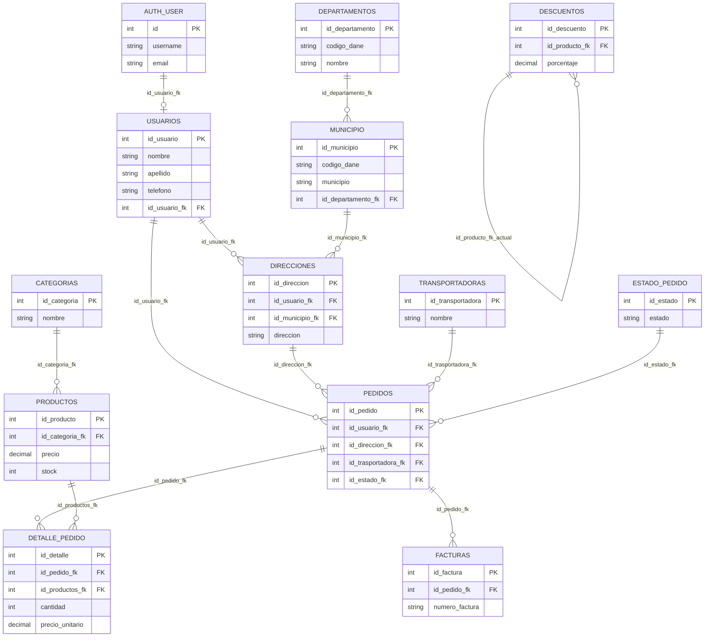

# Modelos y relaciones — Bella Studio

Este diagrama representa los modelos Django de la rama `rama_martinez` **después de la reorganización**. Se conservaron los nombres de tablas y columnas (`db_table`, `db_column`) existentes. No confirma restricciones SQL que no se hayan inspeccionado directamente en MySQL.

## Distribución de responsabilidades

- **usuarios:** Usuarios, Departamentos, Municipio, Direcciones.
- **catalogo:** Categorias, Productos, Descuentos.
- **ventas:** EstadoPedido, Transportadoras, Pedidos, DetallePedido, Facturas.
- **auth.User (Django):** cuentas y credenciales asociadas a Usuarios.

## Diagrama relacional lógico

> **Pendiente crítico de verificación:** el modelo original `Descuentos.id_producto_fk` apunta a `'self'` (la tabla descuentos), aunque por su nombre parece apuntar a `productos`. **No se modificó** esta relación sin conocer la clave foránea real de MySQL. La flecha de descuentos en este gráfico refleja el **código actual**, no necesariamente el diseño deseado.

## Estado de migraciones y precauciones

Las migraciones `0001_initial.py` antiguas conservan declaraciones de modelos duplicados y algunas definiciones anteriores. Esta reorganización es una **refactorización de las clases Python**, no una migración física de la base de datos.

**Antes de generar o aplicar nuevas migraciones:** revisar el plan de cambios y el estado de migraciones; no ejecutar `migrate` a ciegas. La tabla `usuarios` ya está en uso y no debe recrearse.

## Pruebas recomendadas al bajar la rama

1. `python manage.py check`
2. `python manage.py showmigrations`
3. Revisar `python manage.py makemigrations --dry-run --verbosity 2` sin aplicar cambios.
4. Comprobar las consultas ORM y relaciones, preferiblemente en una base de datos de prueba.

**No se cambió ninguna estructura SQL ni se aplicó una migración.**
